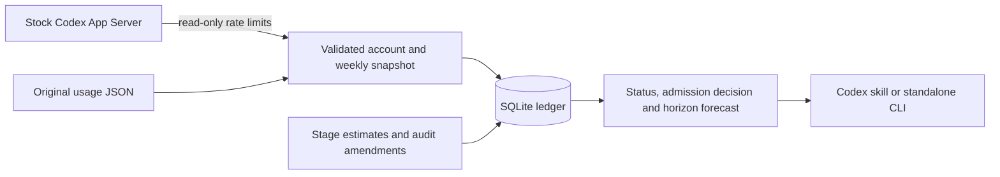

# Codex Budget

Plan multi-stage Codex work from observed weekly quota and an auditable local ledger.
The plugin and dependency-free Python CLI combine fresh quota snapshots, complete-stage
estimates, a **20 percentage-point reserve** and a **3 pp planning buffer**. SQLite
transactions coordinate reservations across clients using the same database.

## Architecture



The workflow is **observe → assess → reserve → finish → retain the audit**.
`assess` reports a planning decision; `start` atomically checks and reserves an
estimate. `finish` marks work ended while retaining its unreconciled estimate.

## Install as a Codex plugin

Requires **Python 3.11+**, stock **Codex CLI 0.159.2+**, an existing signed-in Codex
account and a host/workspace that allows marketplace plugins. CI includes macOS,
Linux and Windows.

```sh
codex plugin marketplace add trukhinyuri/codex-budget --ref v0.2.0
codex plugin add codex-budget@codex-budget-marketplace
codex plugin list --marketplace codex-budget-marketplace --json
```

In Codex Desktop, select **Codex Budget** in the plugin directory, start a new chat
and invoke **`$codex-budget:codex-budget`**. The same marketplace/skill works through
CLI `/plugins`. Restart the host if a newly installed plugin is not visible, and
use the returned `installedPath` rather than guessing a cache directory.

The package contains a skill and ordinary Python scripts. Installation adds no MCP
server, hook, daemon, scheduler, login flow or model call. It leaves model, effort,
speed, payment and authorization preferences unchanged.

For local authoring, add `/absolute/path/to/codex-budget` as the marketplace, then
use the same `plugin add` command. Within the skill, derive the plugin root from the
actual absolute `SKILL.md` path.

## Standalone quick start

From a source checkout or installed plugin, no pip install is required:

```sh
python3 scripts/budget.py doctor
python3 scripts/budget.py status --fresh
python3 scripts/budget.py assess --task-id CHAT:PHASE --root-id CHAT --estimate-pp 1
python3 scripts/budget.py start --task-id CHAT:PHASE --root-id CHAT --estimate-pp 1
python3 scripts/budget.py finish --task-id CHAT:PHASE
```

`1` is an illustrative complete-stage estimate in weekly percentage points, including
helpers, review and retry allowance. It is not a token conversion or an upper cost
bound. Omit `--estimate-pp` when the estimate is unknown; ordinary work then defers.
Use a globally unique stage ID and never reuse an ended ID.

On Windows use `py -3` when appropriate. An optional virtual environment provides
the `codex-budget` console command:

```sh
python3 -m venv .venv
.venv/bin/python -m pip install .
.venv/bin/codex-budget doctor
```

Windows equivalents are `.venv\Scripts\python.exe` and
`.venv\Scripts\codex-budget.exe`. Distribution is through GitHub; these instructions
do not assume a same-named package on PyPI.

## Quota sources and admission rules

| Interface | Source and effect |
| --- | --- |
| `doctor` | Local CLI version/platform/storage checks; no login or live quota check |
| `status --fresh` | Stock App Server `initialize`, `initialized`, then `account/rateLimits/read`; stores the observation, starts no model turn |
| `ingest` | Original `get_usage_limits` JSON on stdin, an MCP text envelope or an App Server result |
| `status` | Ledger snapshot, outstanding estimates and planning headroom |
| `assess` / `start` | Decision without reservation / atomic decision and reservation |
| `finish` | End or cancel a stage; retain its estimate as `unreconciled` |
| `amend` | Audit a newly justified or increased estimate |
| `horizon` | Observed 7-day and 30-day shared-usage forecasts |
| `advise` | Model/effort/team heuristics before a new turn; applies no settings |

The live read disables Luna Reserve and excludes reset-credit details. The utility
does not open credential files; the stock CLI uses its existing session. A later
Codex version must preserve the endpoint contract—version comparison alone is not
compatibility evidence.

`ingest --observed-at` records a timezone-aware original observation time. Importing
an old file does not make it fresh. Account identity and exactly one explicit
**10080-minute weekly window** are required, whether that window is primary or
secondary.

Ordinary admission requires:

```text
observed used pp + outstanding estimates pp + 3 pp buffer + stage estimate pp <= 80
```

- Significant stages need a snapshot at most **60 seconds** old. `--short` permits
  a valid current-window snapshot up to **12 hours** old.
- Unknown identity, quota, permission or costs defer ordinary work. An additional
  nonweekly window also defers ordinary work because its stage cost is unestimated.
- One ordinary root may be active. All clients must share the same database for
  reservations to coordinate; other clients' spending remains uncertainty.
- `--background` defers optional work at remaining quota ≤35% or when measured pace
  projects reserve exhaustion. At remaining ≤20%, only required/urgent warning
  decisions proceed.
- `--priority required|urgent` records a mandatory-work decision with warnings. It
  does not establish a safe cost or authorize bypassing an ordinary deferral.

`status` reports `available=max(0,80-U-P-3)` and a daily guide over the days until
reset, including weekends. Finished/cancelled estimates are not automatically
released: a shared quota delta cannot identify the charge for one stage. A cost
can therefore count in both observed usage and outstanding estimates. Confirmed
new periods are separate; anomalous early resets retain old reservations.

## Forecasts, quality advice and estimate amendments

```sh
python3 scripts/budget.py horizon
python3 scripts/budget.py advise --complexity complex --error-cost high --independent-parts 2
python3 scripts/budget.py advise --explicit-model gpt-6.1-sol --explicit-effort ultra --catalog models.json
```

`horizon` uses observed intervals within the same account and weekly period. It
reports sample coverage and skipped intervals, and needs at least one usable hour
for extrapolation. Account switches, resets, decreases and anomalous transitions
do not create free capacity. Forecasts include shared spending by other clients;
a 30-day projection is not a monthly entitlement.

`advise` considers complexity, uncertainty, error cost, repeatability and objective
verification. Its Luna/High, Sol/Medium, Sol/High and Astra/High suggestions are
heuristics, not measured performance rankings. It starts with at most two independent
workers; unknown budget or quota pressure reduces the suggestion to one. The
coordinator is excluded from that width, while all work still belongs in the stage
estimate. Required work retains its quality checks.

Explicit model/effort choices, including Ultra, are preserved. `--catalog` accepts
the original stock `model/list` response; the caller verifies freshness and pagination.
Missing or unsupported choices produce `settingsReady=false` without silent fallback.
Advice applies only through a supported interface before a new turn; this utility
does not dispatch models or change defaults.

When a complete estimate becomes justified, retain the audit trail:

```sh
python3 scripts/budget.py amend --task-id CHAT:PHASE --estimate-pp 2 \
  --reason "Complete stage now estimated" \
  --evidence "Verified pilot plus planned helpers and retry allowance"
```

The caller verifies that evidence. An amendment can fill an unknown estimate with
a positive value or increase a known estimate; it cannot decrease or release it,
change account/period or reconcile charges. Run `assess`/`start` again afterward.

## Data and configuration

The default data directory is `~/.local/share/codex-budget/`, or the
`XDG_DATA_HOME` equivalent. `ledger.sqlite3` is canonical; `budget-state.json` is
an atomic compatible mirror. Plugin updates replace code, not this data.

| Override | Scope |
| --- | --- |
| `CODEX_BUDGET_DATA_DIR` | Independent installation/data directory; bypasses shared settings |
| Global `--state` / `--db` | Explicit paths, placed **before** the subcommand |
| `CODEX_BUDGET_STATE` / `CODEX_BUDGET_DB` | Individual cache/database paths |
| `~/.config/codex-budget/settings.json` | Optional absolute `state` and `database` paths for a shared ledger; follows XDG config |
| `CODEX_BUDGET_SETTINGS` | Alternate settings file |

Keep runtime data private and out of Git. Credentials and credit balances are not
stored. Account IDs become SHA-256 fingerprints: pseudonymous, not anonymous.
Explicitly supplied custom snapshot metadata remains local. SQLite transactions
serialize reservations and JSON publication; a cache publication failure retains
committed canonical data for repair. Do not edit the database directly.

## Removal

```sh
codex plugin remove codex-budget@codex-budget-marketplace
codex plugin marketplace remove codex-budget-marketplace
```

Removal keeps the ledger in the data directory (`~/.local/share/codex-budget/` by
default). The optional integration has its own `rollback` command, described in
[Architecture & Operational Boundaries](#architecture--operational-boundaries).

## Development

```sh
python3 -m unittest discover -s tests -v
ruff check .
ruff format --check .
python3 scripts/verify_release.py
```

CI tests independent platforms and Python versions, release metadata/archives and
native plugin installation without account secrets or model calls. The release
checker can additionally build a plugin ZIP with `--zip` and verify a built wheel
with `--wheel`. See [quality contract](docs/QUALITY.md),
[contribution guide](CONTRIBUTING.md), [changelog](CHANGELOG.md) and
[русская инструкция](docs/README.ru.md).

## Architecture & Operational Boundaries

Budget is a **best-effort planning layer**, not a server-enforced cap, a universal
Desktop turn interceptor or an automatic stop mechanism. It does not convert tokens
or API prices into subscription quota, measure a reliable per-task charge or prove
the upper cost of the next turn. A skill must be invoked and its decisions followed.

Exit codes are **0** for a report/estimated admission/mandatory warning, **3** for
ordinary deferral, **2** for safe failure and **130** for interruption. Code 0 alone
does not imply safe spending. Process cleanup and transport errors are bounded;
do not weaken security or authentication to force a quota read.

An optional, separate integration installer can append a managed `AGENTS.md` block
and change only the known Sol/Standard baseline from Ultra to Medium:

```sh
python3 -m codex_budget.integration install --apply-sol-medium-defaults
python3 -m codex_budget.integration rollback
```

Run it only after explicitly choosing those global changes, from a persistent
checkout or installed Python environment. It refuses disposable plugin caches,
unexpected defaults and detected later edits on rollback; it backs up first and
does not restore an old quota cache. Avoid concurrent editors: filesystem replace
has no cross-editor compare-and-swap guarantee. On Windows use the generated
PowerShell command and quoting.

The [official plugin format](https://developers.openai.com/plugins/build/plugins),
[Codex plugin commands](https://learn.chatgpt.com/docs/developer-commands),
[App Server](https://learn.chatgpt.com/docs/app-server) and
[subscription rules](https://learn.chatgpt.com/docs/pricing) are the referenced
interfaces. They do not supply this utility with an atomic global quota reservation
or a proven next-turn cost bound. See [security and privacy](SECURITY.md).

Created by [Yuri Trukhin](https://trukhin.com/). Licensed under [MIT](LICENSE).
